  
  
  
  

## ▸ Player 1

> *"A boy who is very stubborn about getting his work done."*

<table>
  <tr><td><b>Player</b></td><td>Tariful Hoque · LC Tarif</td></tr>
  <tr><td><b>Class</b></td><td>Game developer · CSE graduate, East West University</td></tr>
  <tr><td><b>Home turf</b></td><td>Dhaka, Bangladesh</td></tr>
  <tr><td><b>Main quest</b></td><td><a href="https://github.com/LCTarif/beporowa">বেপরোয়া</a>, a Bangla-first street racer for the browser</td></tr>
  <tr><td><b>Play style</b></td><td>Bangla first, every build tested</td></tr>
</table>

## ▸ Main quest: বেপরোয়া (Beporowa)

**An open-world street racer for the browser, in Bangla first.** Drive through বর্ষাবাদ, a city inspired by Dhaka and painted in rickshaw-art colours. Outrun the police, climb a league of ten rivals, and push through monsoon floods and load-shedding while a Bangla radio DJ talks you through the night.

<table>
  <tr>
    <td width="33%"></td>
    <td width="33%"></td>
    <td width="33%"></td>
  </tr>
  <tr>
    <td align="center">Night in পুরানটোলা</td>
    <td align="center">A three-star police chase</td>
    <td align="center">দ্য রিং, under the flyover</td>
  </tr>
</table>

**Quest log**

| Stage | Status |
|---|---|
| Stages 1 to 7: the city, traffic, police, দ্য রিং, the garage, weather, photo mode, replays, ghosts, daily চ্যালেঞ্জ and races with friends | `CLEARED` |
| 279 automated tests | `ALL GREEN` |
| Live on the web at [beporowa.netlify.app](https://beporowa.netlify.app) | `CLEARED` |

[**▸ Play now**](https://beporowa.netlify.app) · [**▸ Source code**](https://github.com/LCTarif/beporowa) · [**▸ Release v0.7.0**](https://github.com/LCTarif/beporowa/releases/tag/v0.7.0)

## ▸ Achievements

| | Achievement | How it was earned |
|:---:|---|---|
|  | **Seven Stages Cleared** | Took বেপরোয়া from an empty road to online leaderboards and friend races, in seven phases |
|  | **All Green** | 279 automated tests, every one passing |
|  | **On Air** | A Bangla radio DJ and police radio chatter, playing inside the game |
|  | **Monsoon Maker** | Rain, flooded roads, fog and load-shedding across a whole day of weather |
|  | **Everyone Plays** | Colour-vision modes, subtitle sizes, high contrast, key remapping and tilt steering |
|  | **Shipped It** | [MessMate BD](https://messmate-bd.netlify.app/) is live for bachelor messes in Dhaka |
|  | **Graduate** | Computer Science and Engineering, East West University |
|  | **Go Live** | Put বেপরোয়া on the open web for anyone to play, at [beporowa.netlify.app](https://beporowa.netlify.app) |

## ▸ Loadout

**Game engine room**

  
  
  
  
  
  
  

**Online and backend**

  
  
  
  
  

**Data, design and tools**

  
  
  
  
  

## ▸ Side quests on [@Majortarif](https://github.com/Majortarif)

| Quest | What it is | Links |
|---|---|---|
| **MessMate BD** | A Bangla-first app for bachelor messes in Dhaka: meals, bazar, bills | [Live](https://messmate-bd.netlify.app/) · [Code](https://github.com/Majortarif/messmate-bd) |
| **Air Quality Prediction** | My capstone: Dhaka's AQI predicted from IoT sensor readings with machine learning | [Live](https://airqualitypredictionapp.netlify.app/) · [Code](https://github.com/Majortarif/Air-Quality-Prediction-using-Machine-Learning-and-AI) |
| **DocuSense** | Answers questions from your documents, with citations, through retrieval (RAG) | [Code](https://github.com/Majortarif/docusense-rag) |
| **AgriCycle** | A Bangla-first farm app that works offline, as a progressive web app | [Code](https://github.com/Majortarif/AgriCycle) |

## ▸ Co-op

Found a bug in বেপরোয়া, or have an idea for the city? [Open an issue](https://github.com/LCTarif/beporowa/issues) or say hi on [LinkedIn](https://www.linkedin.com/in/tariful-hoque-582321259/).

---

  <b>GAME OVER?</b> Not yet. <b>▸ CONTINUE</b> 
  <i>রাস্তায় সাবধানে চালান, শুধু গেমেই বেপরোয়া হোন।</i> 
  Drive carefully on real roads; be reckless only in the game.

