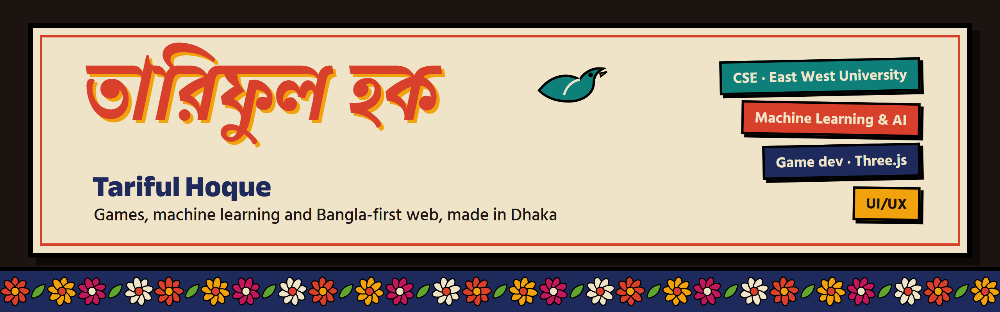

  
  
  

### হ্যালো, I'm Tariful 👋

A Computer Science and Engineering graduate from **East West University**, Dhaka. This account is where I build **games and interactive web experiments**, with Bangla as the first language, not an afterthought.

My machine learning, data and full-stack work lives on my main profile, **[@Majortarif](https://github.com/Majortarif)**.

---

## 🎮 Now building: বেপরোয়া (Beporowa)

**A Bangla-first open-world street racer for the browser.** A living city inspired by Dhaka, painted in rickshaw-art colours: lane traffic, police pursuits, a league of ten rivals, a whole day of weather with monsoon floods and load-shedding, and an original soundtrack with a Bangla radio DJ.

- 🏙️ Three districts of বর্ষাবাদ with left-hand traffic, rickshaws, pedestrians and signals
- 🚓 Police chases from one to five stars, with radio chatter in Bangla
- 🏁 Twelve kinds of race against rivals who remember how you drive
- 🌧️ Day and night, monsoon rain, flooded roads, fog and load-shedding
- 👻 Ghost replays, daily চ্যালেঞ্জ and a free season pass that follows the Bangla seasons
- ♿ Colour-vision modes, subtitle sizes, high contrast, key remapping and tilt steering

  
  
  
  
  
  
  

[**Source code ↗**](https://github.com/Majortarif/beporowa) · Live demo coming soon

---

## 🧰 Toolbox

  
  
  
  
  
  
  
  
  
  
  

## 📌 More of my work on [@Majortarif](https://github.com/Majortarif)

| Project | What it is | Links |
|---|---|---|
| **MessMate BD** | A Bangla-first app for bachelor messes in Dhaka: meals, bazar, bills | [Live](https://messmate-bd.netlify.app/) · [Code](https://github.com/Majortarif/messmate-bd) |
| **Air Quality Prediction** | My capstone: Dhaka's AQI predicted from IoT sensor readings with machine learning | [Live](https://airqualitypredictionapp.netlify.app/) · [Code](https://github.com/Majortarif/Air-Quality-Prediction-using-Machine-Learning-and-AI) |
| **DocuSense** | Answers questions from your documents, with citations, through retrieval (RAG) | [Code](https://github.com/Majortarif/docusense-rag) |
| **AgriCycle** | A Bangla-first farm app that works offline, as a progressive web app | [Code](https://github.com/Majortarif/AgriCycle) |

---

<i>রাস্তায় সাবধানে চালান, শুধু গেমেই বেপরোয়া হোন।</i> Drive carefully on real roads; be reckless only in the game.

